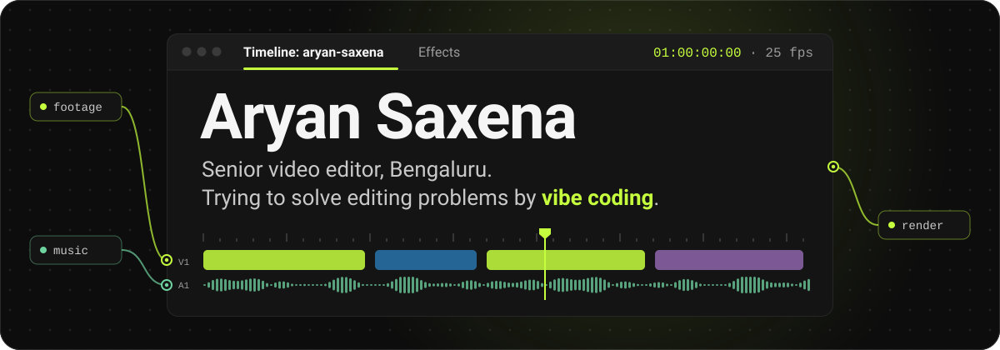
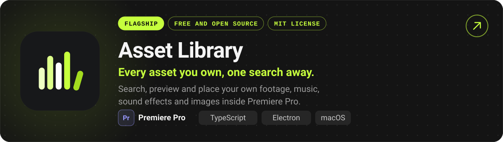
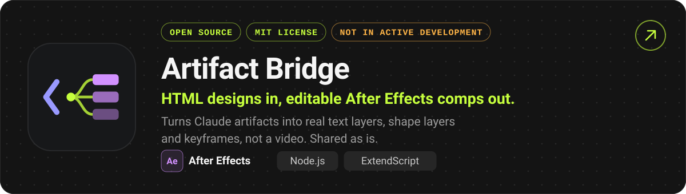
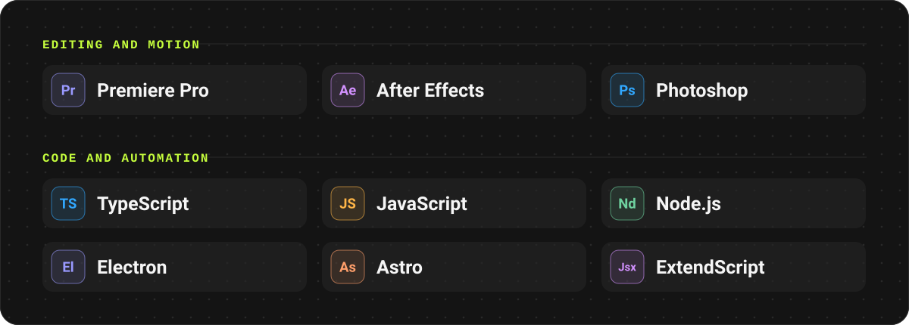
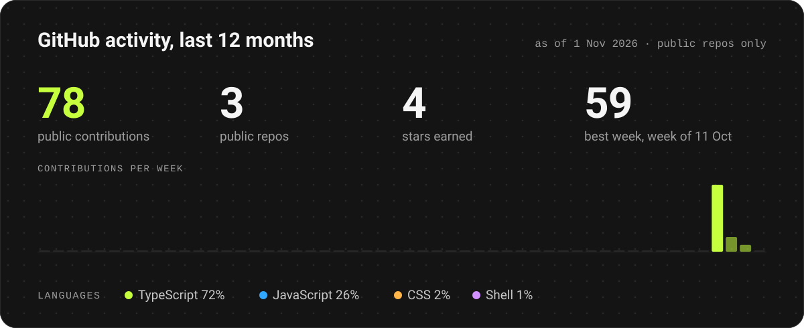
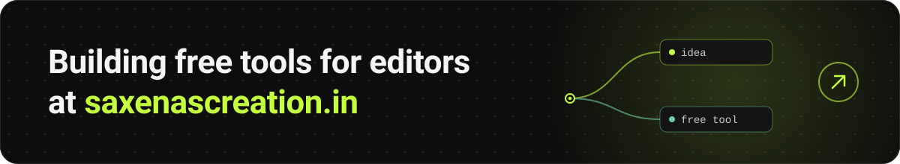

  <a href="https://saxenascreation.in"><b>saxenascreation.in</b></a>
  &nbsp;·&nbsp;
  <a href="https://github.com/saxenaxoxo?tab=repositories"><b>All repositories</b></a>
  &nbsp;·&nbsp;
  Bengaluru, India

### Featured tools

### Toolbox

### Activity

 

